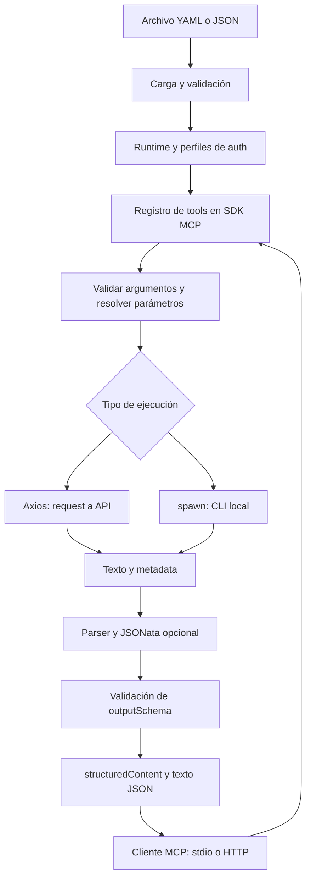

# Arquitectura y funcionamiento interno

[English](en/architecture.md)

[Volver al índice](README.md) · [Guía de desarrollo](desarrollo.md)

El proyecto separa el protocolo MCP de la ejecución de integraciones. Las tools se describen en configuración; el runtime aplica el mismo flujo a todas, independientemente del transporte o del servicio invocado.

## Flujo general

## Responsabilidades por módulo

| Módulo | Responsabilidad |
| --- | --- |
| [cli.ts](../src/cli.ts) | Argumentos de proceso, selección de transporte, validación sin servir, señales de cierre. |
| [config-schema.ts](../src/config-schema.ts) | Esquemas Zod de configuración y tipos inferidos. |
| [config.ts](../src/config.ts) | Lectura YAML/JSON, comprobaciones semánticas, entorno requerido, rutas y prevalidación de respuestas. |
| [templates.ts](../src/templates.ts) | Descubrimiento y resolución de referencias, preservación de tipos y conversión de escalares. |
| [composition.ts](../src/composition.ts) | Carga de composiciones, runtimes por grupo, vistas de catálogo, enrutamiento y ciclo de vida compartido. |
| [runtime.ts](../src/runtime.ts) | Registro compilado de tools, llamadas activas, deadline, validación de datos, resultado y logging. |
| [auth.ts](../src/auth.ts) | Perfiles HTTP, caché de tokens y coordinación de requests OAuth concurrentes. |
| [executors.ts](../src/executors.ts) | Adaptadores Axios y procesos CLI; produce texto y metadata. |
| [response.ts](../src/response.ts) | Ruta de parseo directo o creación/cancelación de workers. |
| [response-worker.ts](../src/response-worker.ts) | Regex, JSONata y serialización dentro del worker. |
| [mcp.ts](../src/mcp.ts) | Registro con SDK, puente AJV, stdio, handler HTTP, guards y listener Node. |
| [errors.ts](../src/errors.ts) | Errores por etapa y mensajes seguros. |

## Arranque

1. La CLI procesa `serve` o `validate` y la ruta `--config`.
2. `loadDeployment` lee el archivo mediante `readConfigFile`, distingue integración y composición, y carga los archivos referenciados. `loadConfig` conserva la API de carga de una integración.
3. `prepareConfig` valida con Zod, aplica defaults, comprueba nombres únicos, compila JSON Schemas y valida referencias, perfiles y URLs.
4. Captura solo variables de entorno referenciadas y normaliza ejecutable/cwd de tools CLI. Comprueba regex y JSONata en workers, sin ejecutar la transformación.
5. Se comprueban el transporte efectivo y el modo. `validate` informa éxito y termina. `serve` construye una `Application`, con un `Runtime` por grupo, y habilita el transporte.

No hay descubrimiento automático de APIs, ejecución previa de CLIs, obtención anticipada de tokens ni observación del archivo. Si falla el arranque, ninguna tool queda disponible parcialmente.

## Contratos internos

Estas interfaces ayudan a navegar el código; no constituyen una API de paquete publicada o versionada por separado.

| Contrato | Contenido |
| --- | --- |
| `LoadedConfig` | `config` normalizada, `directory` del archivo y snapshot `env`. |
| `ToolConfig` / `ExecutionConfig` | Tipos inferidos de Zod; HTTP/CLI se discriminan por `type`. |
| `ExecutionContext` | Input, entorno, `AbortSignal`, deadline configurado y máximo de bytes. |
| `RawResponse` | `{text: string, metadata: Record<string, unknown>}`. |
| `SidecarError` | `stage` y mensaje apto para mostrar al cliente. |
| `LogEvent` | Nombre de tool, duración, éxito y etapa opcional. |

Los adaptadores no devuelven directamente resultados MCP. El runtime procesa `RawResponse`, valida su resultado y forma `CallToolResult`. Esto permite extender ejecutores sin duplicar el resto del flujo.

## Una llamada

El SDK valida los argumentos según la definición publicada. El runtime también valida la entrada, para mantener el mismo contrato cuando se invoca directamente mediante `Runtime.call`.

Después de la validación se crea un deadline y se combinan su señal, la de cierre global y la del consumidor. Se resuelven parámetros y se ejecuta el adaptador. HTTP obtiene credenciales antes del request; CLI construye su entorno explícito e inicia el proceso sin shell.

El parser recibe texto completo. JSON/texto sin transform se procesan directamente; regex o JSONata utilizan un worker por operación. Se valida el objeto resultante y el tamaño del JSON final antes de formar una respuesta exitosa.

Los fallos conocidos se convierten en `isError: true` con un mensaje por etapa. Los fallos inesperados se reemplazan por un mensaje genérico. El bloque `finally` elimina el timer y registra el resultado; un fallo del logger no altera la respuesta de la tool.

## Transportes y estado

**Stdio:** `serveStdio` administra el intercambio MCP y la instancia correspondiente a la conexión. Stdout pertenece al protocolo; logs y diagnósticos van a stderr. El cliente suele administrar el proceso hijo.

**Streamable HTTP:** el SDK construye una instancia MCP por request. El `Runtime` compartido conserva las definiciones, la autenticación y las operaciones activas del proceso. No se crean perfiles ni credenciales independientes por cliente. La compatibilidad de protocolo moderno/legacy la gestiona el SDK.

`createHttpHandler` ofrece una interfaz fetch con validación de hostname, Host si está presente, Origin y ruta. `startHttp` la adapta a `node:http`, valida además el Host original y limita el body entrante. Ambas rutas usan el mismo registro de tools.

El puente `fromJsonSchema` conecta los esquemas de configuración con el SDK. Usa validadores AJV síncronos y caché por identidad de objeto mediante `WeakMap`, sin publicar valores de entorno ni ejecución.

## Concurrencia, cancelación y cierre

Las llamadas pueden correr concurrentemente. No hay una cola global ni un límite configurable de concurrencia. Cada proceso CLI y worker consume recursos propios; cada réplica del servidor mantiene su propia caché de tokens.

OAuth coordina por nombre de perfil: varios consumidores comparten el mismo request de token, pero cada uno puede cancelarse individualmente. La obtención se cancela si no quedan consumidores. Los tokens se cachean únicamente en memoria y no se comparten entre procesos.

`Runtime.close` aborta la señal global, cierra auth y espera las llamadas activas. Los adaptadores propagan la cancelación a Axios, procesos hijos o workers. HTTP también cierra handler, conexiones y listener. En stdio, la CLI cierra el transporte y pausa stdin.

Los límites de tiempo del hilo principal son cooperativos: una operación síncrona no cede control solo porque venció un timer. El worker permite terminar regex/JSONata sin esperar a que la expresión coopere.

## Límites de confianza

El operador controla el archivo, los ejecutables y el entorno del servidor. El modelo solo entrega argumentos declarados. No se cargan módulos TypeScript desde la configuración, ni se evalúa JavaScript dentro de plantillas, pero un ejecutable configurado conserva sus capacidades normales.

Las anotaciones MCP describen efectos; no constituyen autorización. El handler HTTP no autentica usuarios. Los datos de salida no se filtran automáticamente por sensibilidad: parser, transformación y `outputSchema` deben exponer el contrato apropiado para cada integración.

## Composición y vistas de catálogo

`LoadedDeployment` distingue una integración individual de una composición validada. `Application` mantiene los runtimes de los grupos y un mapa de rutas a vistas `ToolCatalog`. Cada catálogo contiene identidad MCP, definiciones de tools y un despachador de llamadas; no copia el estado de ejecución. Los nombres unificados se traducen al nombre original de la tool del grupo. Los endpoints separados publican nombres originales e identidades por grupo.

`createApplicationHttpHandler` despacha rutas exactas a handlers SDK independientes, después de comprobar Host/Origin. `startHttp` abre un listener y comunica todas las URLs publicadas (`urls`); `url` conserva la primera URL publicada por compatibilidad. `createHttpHandler(Runtime)` sigue disponible para integraciones embebidas de un runtime.

Ambas vistas comparten el runtime y la caché OAuth del grupo. Los perfiles homónimos de grupos diferentes son independientes. Los defaults de ejecución y variables referenciadas pertenecen a la integración; las opciones del listener pertenecen a la composición. Esto evita mezclar configuraciones, pero no constituye aislamiento de procesos ni control de acceso por grupo.

`Application.close` y `Runtime.close` son idempotentes. El cierre cancela operaciones de todos los grupos y cierra los handlers HTTP; un fallo al abrir el listener también cierra los runtimes. Los logs de composición agregan el ID del grupo y conservan el nombre original de la tool. Ver [Grupos de tools](grupos-de-tools.md) para configuración y compatibilidad.
