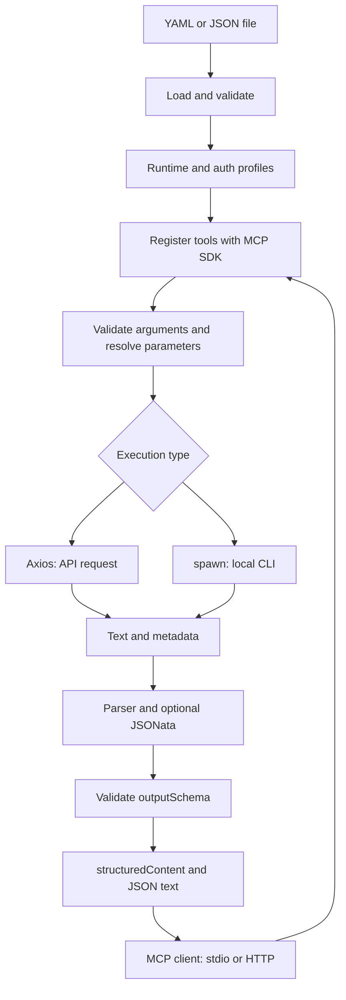

# Architecture and internals

[Back to index](README.md) · [Development guide](development.md) · [Español](../arquitectura.md)

The project separates the MCP protocol from integration execution. Tools are described in configuration; the runtime applies the same flow to all of them, regardless of transport or target service.

## Overall flow

## Module responsibilities

| Module | Responsibility |
| --- | --- |
| [cli.ts](../../src/cli.ts) | Process arguments, transport selection, validation without serving, shutdown signals. |
| [config-schema.ts](../../src/config-schema.ts) | Zod configuration schemas and inferred types. |
| [config.ts](../../src/config.ts) | YAML/JSON loading, semantic checks, required environment, paths, and response prevalidation. |
| [templates.ts](../../src/templates.ts) | Reference discovery and resolution, type preservation, and scalar conversion. |
| [runtime.ts](../../src/runtime.ts) | Compiled tool registry, active calls, deadlines, data validation, results, and logging. |
| [auth.ts](../../src/auth.ts) | HTTP profiles, token cache, and coordination of concurrent OAuth requests. |
| [executors.ts](../../src/executors.ts) | Axios and CLI process adapters; produces text and metadata. |
| [response.ts](../../src/response.ts) | Direct parsing or worker creation/cancellation. |
| [response-worker.ts](../../src/response-worker.ts) | Regex, JSONata, and serialization inside the worker. |
| [mcp.ts](../../src/mcp.ts) | SDK registration, AJV bridge, stdio, HTTP handler, guards, and Node listener. |
| [errors.ts](../../src/errors.ts) | Stage-specific errors and safe messages. |

## Startup

1. The CLI processes `serve` or `validate` and the `--config` path.
2. `loadConfig` reads the file, determines the format from its extension, and parses it.
3. `prepareConfig` validates with Zod, applies defaults, checks unique names, compiles JSON Schemas, and validates references, profiles, and URLs.
4. It captures only referenced environment variables and normalizes executable/cwd paths for CLI tools. It checks regex and JSONata in workers without running the transformation.
5. `validate` reports success and exits. `serve` builds a `Runtime` and enables the selected transport.

There is no automatic API discovery, advance CLI execution, token prefetching, or file watching. If startup fails, no partial set of tools becomes available.

## Internal contracts

These interfaces help navigate the code; they are not a published or separately versioned package API.

| Contract | Contents |
| --- | --- |
| `LoadedConfig` | Normalized `config`, file `directory`, and `env` snapshot. |
| `ToolConfig` / `ExecutionConfig` | Types inferred from Zod; HTTP/CLI are discriminated by `type`. |
| `ExecutionContext` | Input, environment, `AbortSignal`, configured deadline, and maximum bytes. |
| `RawResponse` | `{text: string, metadata: Record<string, unknown>}`. |
| `SidecarError` | `stage` and a client-safe message. |
| `LogEvent` | Tool name, duration, success, and optional stage. |

Adapters do not return MCP results directly. The runtime processes `RawResponse`, validates its result, and builds `CallToolResult`. This allows executors to be extended without duplicating the rest of the flow.

## A single call

The SDK validates arguments against the exposed definition. The runtime also validates input to preserve the same contract when called directly through `Runtime.call`.

After validation, a deadline is created, and its signal is combined with the global shutdown and consumer signals. Parameters are resolved and the adapter runs. HTTP obtains credentials before the request; CLI builds its explicit environment and starts the process without a shell.

The parser receives the complete text. JSON/text without a transform run directly; regex or JSONata use one worker per operation. The resulting object and final JSON size are validated before building a successful response.

Known failures become `isError: true` with a stage-specific message. Unexpected failures are replaced with a generic message. The `finally` block removes the timer and logs the outcome; logger failures do not change the tool response.

## Transports and state

**Stdio:** `serveStdio` manages the MCP exchange and the instance associated with the connection. Stdout belongs to the protocol; logs and diagnostics go to stderr. The client usually manages the child process.

**Streamable HTTP:** the SDK builds an MCP instance per request. The shared `Runtime` holds the process's definitions, authentication, and active operations. Separate profiles or credentials are not created per client. The SDK manages modern/legacy protocol compatibility.

`createHttpHandler` exposes a fetch interface with validation for the hostname, Host when present, Origin, and path. `startHttp` adapts it to `node:http`, additionally validates the original Host, and limits the incoming body. Both paths use the same tool registry.

The `fromJsonSchema` bridge connects configuration schemas to the SDK. It uses synchronous AJV validators and a `WeakMap` cache keyed by object identity, without exposing environment or execution values.

## Concurrency, cancellation, and shutdown

Calls can run concurrently. There is no global queue or configurable concurrency limit. Each CLI process and worker consumes its own resources; each server replica maintains its own token cache.

OAuth coordinates by profile name: multiple consumers share the same token request, but each can cancel individually. Retrieval is canceled when no consumers remain. Tokens are cached only in memory and are not shared across processes.

`Runtime.close` aborts the global signal, closes auth, and waits for active calls. Adapters propagate cancellation to Axios, child processes, or workers. HTTP also closes the handler, connections, and listener. For stdio, the CLI closes the transport and pauses stdin.

Main-thread time limits are cooperative: a synchronous operation does not yield control just because a timer expires. The worker allows regex/JSONata to be terminated without waiting for the expression to cooperate.

## Trust boundaries

The operator controls the file, executables, and server environment. The model supplies only declared arguments. TypeScript modules are not loaded from configuration, and templates do not evaluate JavaScript, but a configured executable retains its normal capabilities.

MCP annotations describe effects; they do not provide authorization. The HTTP handler does not authenticate users. Output data is not automatically filtered for sensitivity: the parser, transformation, and `outputSchema` must expose the appropriate contract for each integration.
